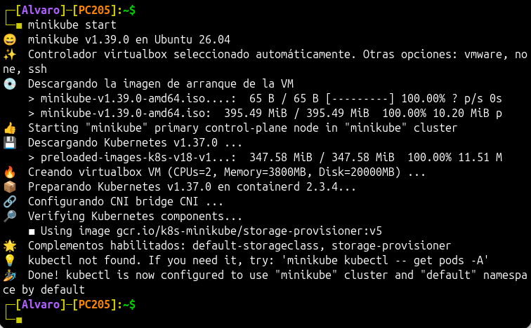

# INSTALACIÓN KUBERNETES


```bash
# Explicación de lo que hace
curl -LO https://github.com/kubernetes/minikube/releases/latest/download/minikube-linux-amd64

# Explicación de lo que hace
sudo install minikube-linux-amd64 /usr/local/bin/minikube && rm minikube-linux-amd64
```

Activación del autocompletado de comandos

### REVISAMOS QUE TENEMOS MINIKUBE DESCARGADO EN EL EQUIPO:

```
ls -lh minikube-linux-amd64
```

Tras la comprobación, vamos a ejecutar `minikube start`, se nos empezará a descargar una máquina minikube:


